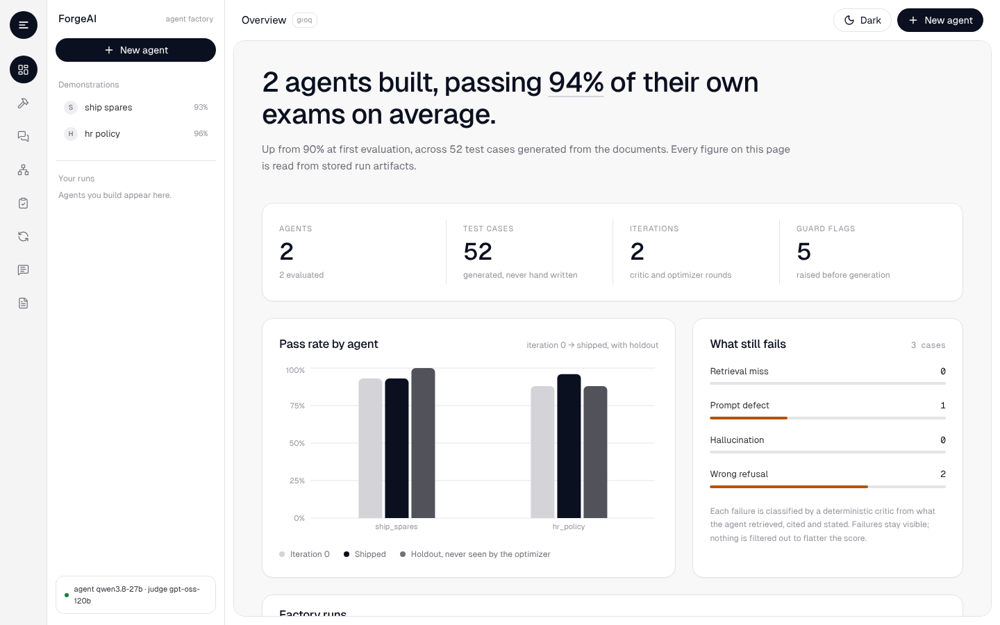
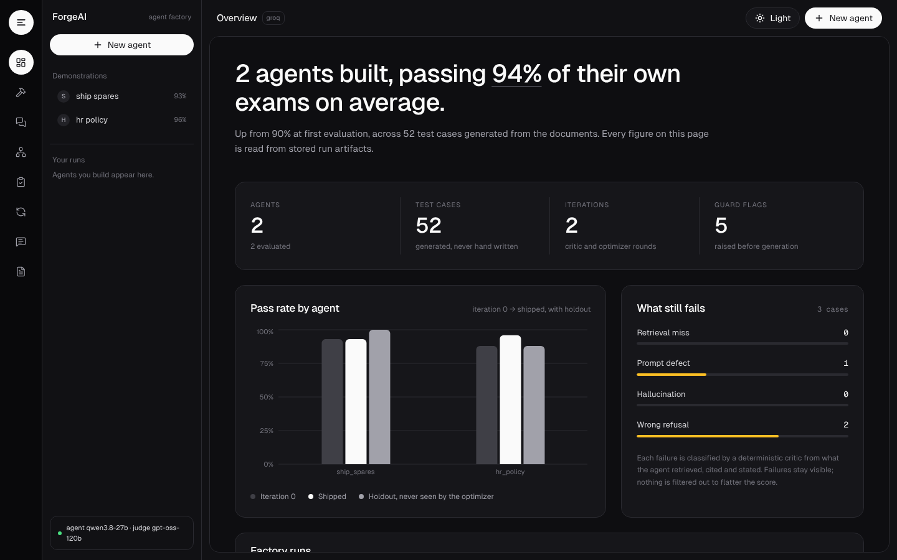
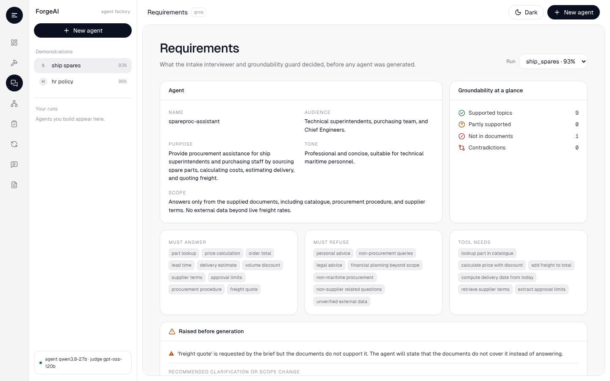
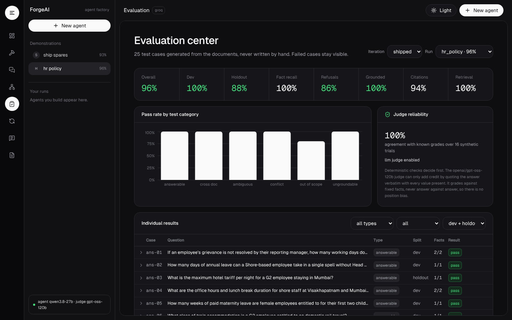
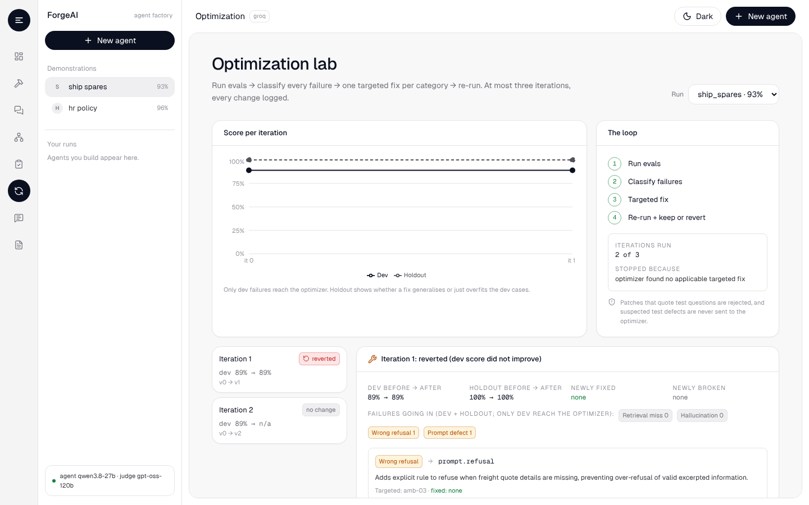
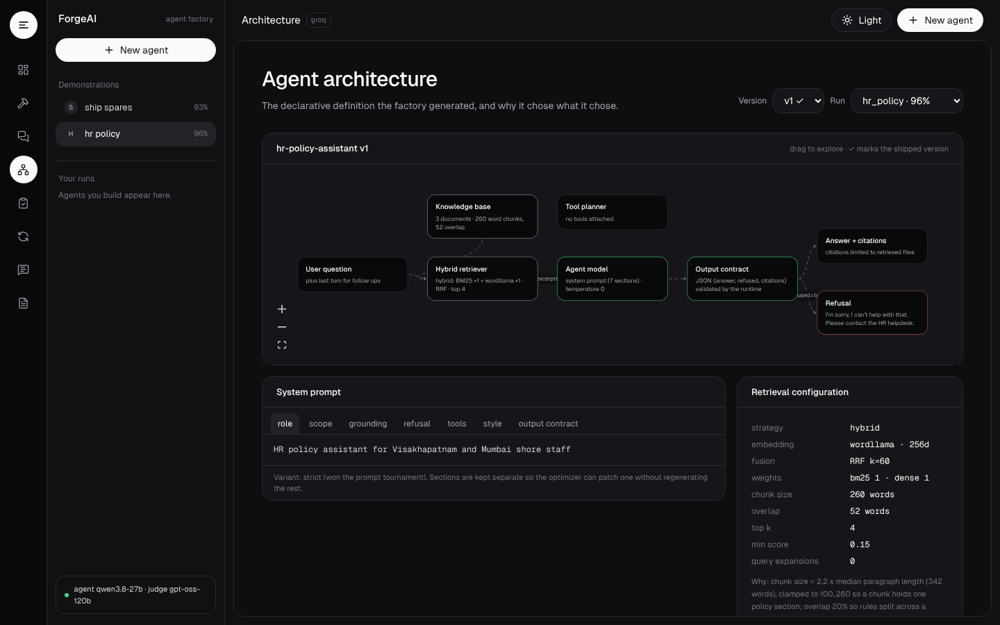
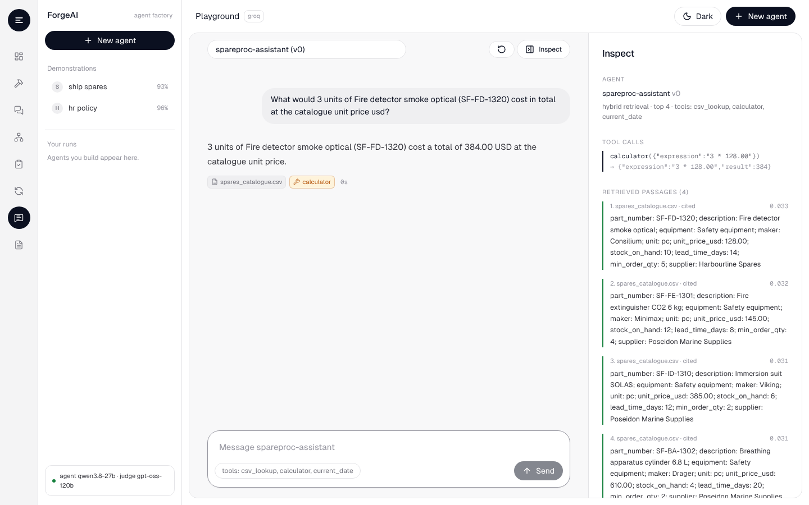
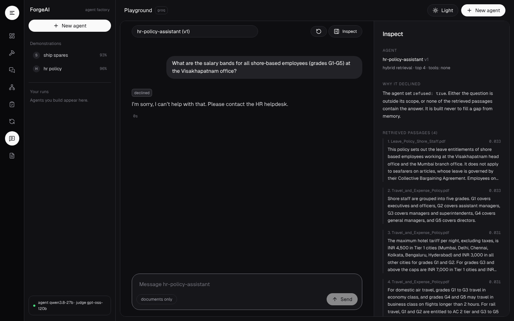

# ForgeAI: the agent that builds agents

Give ForgeAI a one paragraph brief and a folder of documents. It interviews you, checks whether the documents can
actually support what you asked for, generates a grounded agent with only the tools it needs, writes its own exam
from the documents, grades the agent, diagnoses every failure, applies targeted fixes for up to three rounds, and
hands back the agent with a report that says plainly what still fails and why.

Built for the OceanAI Jr. GenAI Engineer campus assignment. Everything in `runs/` was produced by the pipeline itself.

> **Design principle: the model proposes, deterministic code verifies.** Every stage runs on small open models,
> and each stage's output feeds the next. So wherever a model makes a claim that matters (this topic is supported,
> this fact is in the passage, these documents contradict each other, this answer states that fact), code checks
> the claim against the documents or the answer before anything is built on it.

## Results

| Demo | Cases | Iteration 0 | Shipped | Dev / holdout | Hallucinations | Refusal accuracy | Tools attached | Guard found | Readiness |
|---|---|---|---|---|---|---|---|---|---|
| [hr_policy](runs/hr_policy/REPORT.md) | 25 | 88% | **96%** | 100% / 88% | 0 | 86% | none | 2 gap(s), 1 contradiction(s) | pilot only with human review of answers |
| [ship_spares](runs/ship_spares/REPORT.md) | 27 | 93% | **93%** | 89% / 100% | 0 | 100% | csv_lookup, calculator, current_date | 1 gap(s), 0 contradiction(s) | ready for a supervised pilot |
| [rehearsal_it_helpdesk](runs/rehearsal_it_helpdesk/REPORT.md) | 29 | 90% | **90%** | 86% / 100% | 0 | 100% | csv_lookup | 2 gap(s), 1 contradiction(s) | ready for a supervised pilot |

*Table generated by `scripts/results_table.py` from the committed artifacts.*

**HR policy assistant** (3 PDFs, brief also asks for salary bands and payroll dates)
- The guard flagged *salary band* and *payroll dates* as not in the documents before any agent existed, and the agent
  declines them instead of inventing numbers.
- It caught a planted contradiction (gifts up to INR 2,000 in the code of conduct vs INR 5,000 on official trips); the
  agent gives both rules with their sources. The second model's dissent is recorded next to it.
- No tools attached: the model was offered all four and none was justified by the brief.
- One optimizer iteration was kept (88% → 96%, fixed 2 cases, broke none); the loop then stopped with no dev failures left.
- Readiness is "pilot only with human review" because refusal accuracy (86%) is below the 90% bar: the remaining failure
  is a legal question the agent answered from policy instead of declining. It stays in the report.

**Ship spares procurement assistant** (catalogue CSV + 2 supplier terms PDFs + procurement procedure)
- Attached exactly `csv_lookup`, `calculator` and `current_date`; rejected the weather tool. Tool test cases are
  computed in Python from the catalogue, so expected totals are exact.
- The guard marked "live freight quotes" as unservable, treated order totals and delivery dates as computable by tools,
  and did not mistake two suppliers' different terms for contradictions: all 12 candidate pairs, such as the two
  suppliers' urgent order surcharges, were checked and rejected by the decider (see `conflict_checks` in `requirements.json`).
- The optimizer's one attempt did not improve dev, so it was reverted and v0 ships at 93%. One remaining failure is a
  real agent miss on informal phrasing ("$12k purchase order"); the other is flagged as a suspected test defect.

**Rehearsal on a brief the factory had never seen: IT helpdesk** (3 IT policy PDFs + a device catalogue CSV, a different fictional company)

The review runs ForgeAI unattended on an unseen brief, so we did the same first, with no answers file (every intake
question takes the interviewer's own default). The blind attempt is committed as it ran:
[`runs/rehearsal_it_helpdesk_blind`](runs/rehearsal_it_helpdesk_blind/REPORT.md). It exposed five generic weaknesses:

| Found in the blind run | Generic fix (each with a unit test) |
|---|---|
| Unattended, the interviewer assumed "use the existing ticketing system API", inventing an integration | An assumed answer can never grant an integration or live system |
| The brief asked for live ticket status and whether systems are down right now; the requirements shortened this to "system outage status", which a document about outage procedures appeared to support | The guard also reads the brief's own wording for live data cues and overrules document support for them |
| A planted contradiction (passwords change every 90 days vs every 60 for new joiners) was dismissed as a different scope | A universal scope ("all employees") overlaps any narrower group of people, but not a named organisation |
| An "out of scope" test asked for the remote work policy, which has its own section | Out of scope candidates are rejected when a section heading covers them |
| Two tests expected an unrelated fact or a document title; the judge blamed the agent | Such tests are flagged as suspected test defects and kept out of the optimizer |

Rerunning the same blind rehearsal surfaced one more: a numbered step ("4.") in an answer was scored as an
unsupported number. Fixed too. Then all three runs were rebuilt with the final code; both demos reproduced their
committed results exactly.

| Rehearsal | Shipped | Dev / holdout | Refusal accuracy | Gaps flagged | Contradictions | Readiness |
|---|---|---|---|---|---|---|
| Blind attempt | 80% | 72% / 100% | 80% | 0 | 0 | pilot only with human review |
| After the generic fixes | **90%** | 86% / 100% | 100% | ticket status, system outage | password change frequency | ready for a supervised pilot |

What still fails, honestly: two tests expect the two word fragment "pre approved", which the question did not ask
for (a weak test our defect check misses, because it skips facts under three words), and one is a real agent miss
(it refused "when do we get new laptops?" although the 4 year refresh cycle was in the retrieved passage). We did
not tune further against the rehearsal: that would only teach the factory this one brief.

### How we know it's not lying

The brief says the strong candidates are the ones who distrust their own pipeline. Here is every way ForgeAI could
fool itself, the check that catches it, and where the evidence is in the committed runs.

| How the factory could lie to you | The check that catches it | Evidence |
|---|---|---|
| The guard says a topic is covered when it isn't | A topic counts as supported only with a quote that code finds in the documents | Salary band, payroll dates and live freight quotes flagged before any agent existed |
| The guard invents contradictions, or misses real ones | Candidates found by embeddings and headings; a second model decides; a scope overlap check; both votes logged | Planted gift contradiction (HR) and password contradiction (rehearsal) caught. In ship spares all 12 candidate pairs were rejected, because two suppliers' different terms are not a contradiction (`conflict_checks`) |
| The eval set tests the wrong things | Every expected fact is verified in its source passage, checked as actually needed by the question, and deduplicated. Cross doc cases need a fact from each document. Tool answers are computed in Python | 12 and 13 generated cases rejected, each with its reason, in `eval_generation_log.json` |
| The judge is fooled by its known biases | No side by side comparisons (position bias). A different model family from the agent (self preference). Yes or no per fact, credited only with a quote from the answer and every number present (verbosity) | `forgeai/judge.py` |
| The judge itself is broken | Self test on gold, corrupted and padded answers before every run; the LLM judge is switched off below 80% | 16 of 16 on every run (`judge_selftest.json`) |
| A made up number passes as correct | Any number in an answer that is not in the retrieved evidence counts as a hallucination | 0 hallucinations in every run |
| A broken test is blamed on the agent | Suspected test defects are flagged, reported and kept out of the optimizer | 1 flagged in ship spares, listed in its report |
| The optimizer overfits the tests | Patches that quote eval questions are rejected; dev and holdout split; a change is reverted unless dev improves | Ship spares iteration reverted; v0 shipped |
| The headline score is picked from the best moment | The report uses the scorecard of the version actually shipped, with holdout shown | `REPORT.md` in each run |
| A green regression rerun hides untested changes | Sentence level document diff, strict test coverage matching, untested changes listed | All 6 HR policy changes flagged as untested |
| It only works on the demos it was built for | Run unattended, with no answers file, on a third domain it was never tuned on; the blind attempt is kept | `runs/rehearsal_it_helpdesk_blind` and `runs/rehearsal_it_helpdesk` |

### Screenshots

| | |
|---|---|
|  |  |
|  |  |
|  |  |
|  |  |

More in [docs/screenshots](docs/screenshots).

### Human baseline and regression

**Human baseline.** I wrote an HR agent definition by hand (`baseline/hr_human_agent.json`, about 25 minutes, without looking at the eval set) and ran it on the same 25 cases with the same agent model, judge and retrieval engine. Full table: [`runs/hr_policy/BASELINE_COMPARISON.md`](runs/hr_policy/BASELINE_COMPARISON.md).

| Metric | Factory agent | Human baseline |
|---|---|---|
| Overall pass rate | 96% | 88% |
| Holdout | 88% | 88% |
| Fact recall | 100% | 88% |
| Refusal accuracy | 86% | 100% |
| Citation precision | 94% | 100% |

The factory agent wins on completeness: it passes three cases (`ans-10`, `cro-01`, `cro-02`) where the human prompt found the right passage but left out a required fact, two of them about the gift declaration threshold. The human prompt is the better refuser: it correctly declines `out-03` (a legal affidavit question) that the factory agent answers. On the holdout split the two are level, so the honest reading is "the factory matches a careful hand-written prompt and is more thorough, but refuses less strictly".

**Regression mode.** `forgeai regress` re-runs the old eval set after the documents change (`demos/hr_policy/docs_v2`: annual leave 21 to 24 days, accrual 1.75 to 2 days, carry forward 10 to 15 days, paternity leave 5 to 10 days). It runs two agents on the new documents. One is the agent the factory regenerates from the same requirements, as the brief asks. The other is the shipped definition replayed unchanged, which isolates the effect of the document change. Full report: [`runs/hr_policy_regression/REGRESSION.md`](runs/hr_policy_regression/REGRESSION.md).

| Agent | Pass rate on the old eval set |
|---|---|
| Shipped agent, old documents | 96% |
| Regenerated agent, new documents | 88% |
| Replayed agent, new documents | 96% |

Two findings. First, the regenerated agent broke `ans-10` and `amb-03`, and the report traces both to the same cause: they only passed because the critic loop patched the prompt for them in iteration 1, and a fresh generation starts again from v0. So a real rebuild must run the full loop, not just the generator. Second, all three numbers hide something: none of the six changed sentences is covered by an existing test, and the report says so instead of showing a green 96%.

## How it works

```
brief + documents
  → 1 Intake interviewer      ≤5 questions, skips anything the documents already answer
  → 2 Groundability guard     supported / partial / unsupported per topic (verified quotes), contradictions across documents
  → [human checkpoint]        approve or edit the requirements (web UI or --approve)
  → 3 Agent generator         sectioned system prompt, hybrid retrieval config, tools = LLM proposal ∩ evidence
  → 4 Eval generator          ≥20 validated cases from the documents, dev / holdout split
  → 5 Judge                   deterministic checks first, verified LLM credit second, self test before use
  → prompt tournament         candidate prompts, the eval set picks the winner
  → 6 Critic → optimizer      classify every failure, one targeted fix per category, keep only if dev improves (≤3 rounds)
  → 7 Report                  scorecard per iteration, remaining failures, readiness verdict, known limitations
runtime: generic chat runner that loads any produced agent definition (CLI + web playground)
```

Full design notes, including how each LLM judge bias is defended against: [DESIGN.md](DESIGN.md).

### The nine requirements, and where each lives

| # | Requirement | Implementation |
|---|---|---|
| 1 | Intake interviewer | `forgeai/intake.py`, prompts `intake_questions.md`, `intake_requirements.md` |
| 2 | Groundability guard | `forgeai/guard.py`, prompts `guard_topic.md`, `guard_conflict.md` |
| 3 | Agent generator | `forgeai/generator.py`, `forgeai/tools.py` (registry: csv_lookup, calculator, weather_forecast, current_date) |
| 4 | Eval generator | `forgeai/evalgen.py`, prompts `evalgen_*.md` (committed, as required) |
| 5 | Judge | `forgeai/judge.py`, prompt `judge_facts.md` |
| 6 | Critic + optimizer | `forgeai/critic.py`, `forgeai/optimizer.py`, prompts `optimizer_*.md` |
| 7 | Honest report | `forgeai/report.py` → `runs/<name>/REPORT.md` |
| 8 | Runnable agent | `forgeai/runner.py`, `forgeai chat`, web Playground |
| 9 | Two demos | `demos/hr_policy`, `demos/ship_spares` → `runs/hr_policy`, `runs/ship_spares` |

Stretch goals implemented: prompt tournament, token and time budget with early stopping, human checkpoint
(CLI `--approve` and the web UI's requirements review), regression mode (`forgeai regress`), a hand-written
human baseline for comparison (`baseline/`), and a web interface with a Docker image for free hosting.

## Quick start

Requirements: Python 3.10+, Node 18+ (only to rebuild the web UI).

```bash
pip install -r requirements.txt
cp .env.example .env            # put GROQ_API_KEY in it (free at console.groq.com), or use Ollama
export $(grep -v '^#' .env | xargs)

# run the factory end to end on a demo (unattended, recorded intake answers)
python -m forgeai build --config demos/demo_config.yaml \
  --brief demos/hr_policy/brief.txt --docs demos/hr_policy/docs \
  --answers demos/hr_policy/answers.yaml --out runs/my_hr --unattended

# chat with the agent it produced
python -m forgeai chat runs/my_hr/agent_definition.json --config demos/demo_config.yaml
```

Your own brief and documents: drop `--answers` and `--unattended` and ForgeAI will ask its questions in the
terminal (press Enter to accept a suggested default). Add `--approve` to review the requirements before generation.

### Web interface

```bash
cd web && npm ci && npm run build && cd ..
uvicorn forgeai.server:app --port 7860      # open http://localhost:7860
```

Pages: Overview, Create agent, Requirements (human checkpoint), Architecture, Evaluation, Optimization, Playground,
Reports. Light and dark themes. Every number comes from artifacts on disk. Without a reachable model the app runs
in clearly labelled mock mode. Free hosting on Render: [hosting/RENDER.md](hosting/RENDER.md) (the same image also runs on a Hugging Face Space, which now needs a paid plan: [hosting/HUGGINGFACE_SPACE.md](hosting/HUGGINGFACE_SPACE.md)).

### Fully local (no internet)

```bash
ollama pull qwen2.5:7b-instruct && ollama pull llama3.1:8b
FORGE_BACKEND=ollama FORGE_MODEL=qwen2.5:7b-instruct FORGE_JUDGE_MODEL=llama3.1:8b python -m forgeai build ...
```
Embeddings (WordLlama) ship inside the pip package, and the fonts ship inside the web build, so nothing is
downloaded at runtime.

### Other commands

```bash
python -m forgeai eval --definition baseline/hr_human_agent.json --run runs/hr_policy --name human_baseline
python -m forgeai regress --old-run runs/hr_policy --docs demos/hr_policy/docs_v2 --out runs/hr_policy_regression
python -m pytest -q                         # offline test suite (deterministic mock model, no network)
python scripts/retrieval_benchmark.py      # keyword vs dense vs hybrid retrieval on paraphrased questions
```

## Models

The committed demo runs use small open models on Groq's free tier, with roles split so no single model's daily
token quota (200k tokens per model per day) blocks a run:

| Role | Model | Why |
|---|---|---|
| Factory (intake, generation, eval writing, optimizer) | `openai/gpt-oss-20b` | open weights, 21B MoE with 3.6B active parameters |
| Agent (answers users) | `qwen/qwen3.8-27b` | open weights; the produced agent runs on it |
| Judge | `openai/gpt-oss-120b` | a different model family from the agent, against self preference bias |
| Contradiction decider | `qwen/qwen3.8-27b` | was more accurate than gpt-oss-20b at telling contradictions from two suppliers' different terms |

Any backend works: `ollama` (local), `groq`, `openai` (any OpenAI compatible server), or `mock` (tests).
Retrieval is hybrid: BM25 plus WordLlama embeddings, fused with reciprocal rank fusion.

## Repository map

```
forgeai/        pipeline: llm, docs, retrieval, embeddings, tools, intake, guard, generator, evalgen, judge,
                critic, optimizer, report, runner, pipeline, server, cli, mock
prompts/        every prompt the factory uses (including the eval generation prompts)
demos/          the two briefs, recorded intake answers, documents, and demo_config.yaml
rehearsal/      the unseen-brief rehearsal: IT helpdesk brief and documents (no answers file)
synthesis/      how the demo documents were made (prompts + source texts + PDF builder)
runs/           committed artifacts of every run: both demos, the rehearsal (blind and final), regression
baseline/       a hand-written HR agent definition, for comparison with the generated one
web/            React + TypeScript dashboard
tests/          offline test suite (pipeline + API)
```

## Honest limitations

- The eval set is written by the same family of small model that builds the agent. Holdout cases and validation
  reduce this blind spot; they do not remove it.
- Expected facts are short strings. A correct answer phrased differently can be marked wrong. Such cases are
  flagged as suspected test defects in the report, still counted as failures, and kept away from the optimizer.
- Out of scope tests are only as adversarial as the generator makes them; jailbreak style attacks are not covered.
- BM25 plus static embeddings miss some paraphrases; the optimizer's learned query expansions only cover wording seen in dev failures.
- Demo documents are synthetic (prompts in `synthesis/PROMPTS.md`), including one deliberately planted contradiction.
